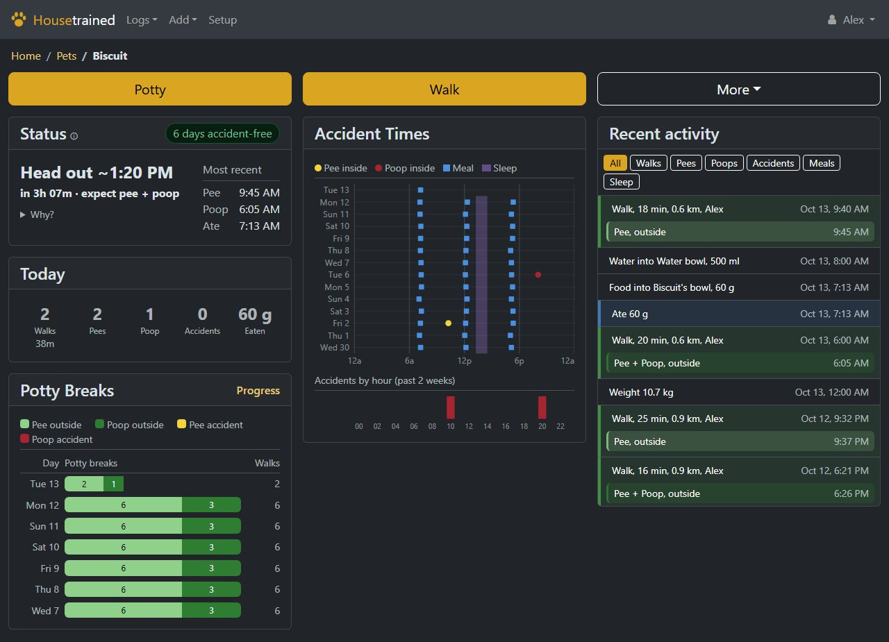
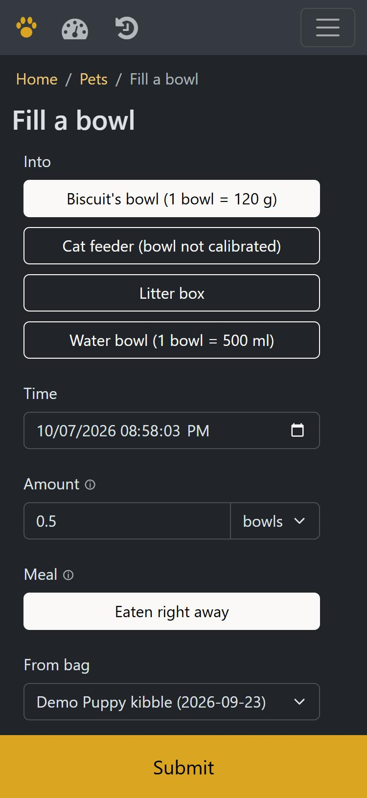

# Housetrained

Track your pets' potty breaks, walks, meals, water, sleep and supplies, and get a guess at when the next walk
is due. Built for puppy house-training first, and works for cats and other pets too. Self-hosted, private,
works on phones.

Housetrained is a fork of [Baby Buddy](https://github.com/babybuddy/babybuddy). New puppy *and* a new baby?
Turn on baby mode and track both in one place: babies sit next to the pets on the home page, with all of
Baby Buddy's baby tracking (feedings, diapers, sleep, pumping, growth) under the Baby menu.





## What it does

- **Potty breaks**: pee, poop, where (outside, inside, pad, litter box; each pet has its own list), linked to
  the walk they happened on.
- **Walks**: one tap to start, one to end; for one pet or several; who walked, how far.
- **Next walk**: a simple schedule you set (pee every, poop every, out after a meal), with a coach that suggests
  changes from the accidents. See [how it works](docs/housetrained/schedule.md).
- **Food, water and litter**: what went into bowls, feeders and litter boxes, what each pet ate and drank, how
  much is left in each bag and when to buy more.
- **Sleep, weight, height, notes**, charts of the past two weeks, a day-by-day timeline.
- **Households**: everyone in the home logs together; owners, members and read-only people.
- **Phones first**: big buttons, forms that only show what applies, light and dark themes, metric or imperial.
- **Reminders** as phone or browser notifications, if you allow them: when a walk is due, when it's time to
  buy more food or litter (see [Private by design](#private-by-design)).
- **CSV import** for past records and a [REST API](docs/housetrained/api.md).

<br clear="right">

## Fill Bowl or Log Meal?

They're two different things, and that matters for the schedule:

- **Fill Bowl**: food, water or litter went into a bowl, feeder or litter box. It counts toward the bag, so you
  know how much is left. It says nothing about who ate it, or when.
- **Log Meal**: a pet ate or drank. Meals are what Next Walk uses: out a set time after eating or drinking.

Feed set portions that get eaten straight away (most dogs)? Tick **Eaten right away** when filling the bowl and
both are logged at once; the form remembers your usual amount for each bowl. Pets that graze from a bowl or
feeder (many cats): just top up with Fill Bowl, and log a meal when you notice them eating.

## Getting started

You need Docker. Copy [`compose.example.yaml`](compose.example.yaml) to `compose.yaml`, set your time zone and
the address you'll open it at, then:

```bash
docker compose up -d --build
```

Open `http://localhost:8000` and sign in as `admin` with the password printed in the log
(`docker compose logs housetrained`), or the one you set as `ADMIN_PASSWORD`. Change it under user menu >
Password.

Then, under **Setup**: add your pets, their bowls and litter boxes, and the food you buy. Calibrating a bowl
(weigh one usual scoop) lets "half a bowl" turn into grams. Want to look around first? Load a demo household:

```bash
docker compose exec -w /app/www/public housetrained /lsiopy/bin/python3 manage.py housetrained_demo
```

(`--delete` removes it again.)

### Settings

| Variable | What it does |
|---|---|
| `TZ` | Server time zone (each person can pick their own in user settings) |
| `ALLOWED_HOSTS` | Hostnames it answers to, comma-separated |
| `CSRF_TRUSTED_ORIGINS` | Every address you open it at, e.g. `https://pets.example.com` |
| `SECURE_PROXY_SSL_HEADER` | `True` behind a reverse proxy that handles HTTPS |
| `ADMIN_PASSWORD` | Password for the first admin (otherwise random, shown once in the log) |
| `BABY_MODE` | `True` to track babies alongside pets (also a switch in Site Settings) |
| `PUSH_CONTACT` | Your `mailto:` address, sent with notifications so push services can reach you |
| `REMINDERS` | `False` to stop the server sending reminders |
| `HOUSETRAINED_SOURCE_URL` | Link shown as "Source Code" in the user menu |

Baby Buddy's other settings (database, email, sign-in options) still work; see
[Baby Buddy's configuration docs](docs/configuration). Security notes: [docs/housetrained/security.md](docs/housetrained/security.md).

People: the admin creates accounts (user menu > Users; tick "Site admin" only for people who should manage the
site) and adds them to the household (Setup > Members), where their role is set. Roles cover pets and babies.

## Backups and updates

Everything lives in the `config` folder: the database (`data/db.sqlite3`), pet photos (`media`) and the
server's generated keys and settings. Stop
the container and copy that folder to back up; copy it back to restore. To update, pull the new version and
run `docker compose up -d --build` again; database changes apply on start.

## Private by design

Housetrained runs entirely on your server. Pages load nothing from the internet (every script, style, font and
icon is bundled), and the app sends nothing anywhere: no analytics, no update checks, no accounts elsewhere.
A test (`pets/tests/test_privacy.py`) fails if a page ever loads something from outside.

The one exception is optional: **notifications**. Browsers deliver push notifications through their maker's
push service (Apple, Google or Mozilla), so turning them on for a device means your server hands encrypted
messages to that service. They can't read the content, but they do see that a message was sent to that device,
and when. They're off until a site admin allows them (Site Settings > Allow push notifications), and even
then each person turns them on for their own devices (user menu > Notifications). `REMINDERS=False` keeps them
off regardless. Email (password resets) is only sent if you set up a
mail server.

## Not veterinary advice

Predictions and charts are estimates from your own logs. Sudden changes in potty habits, eating or drinking are
worth a call to your vet.

## Development

```bash
pip install pipenv && pipenv install --dev
pipenv run python manage.py test
```

The pet code lives in `pets/`; design notes in [docs/housetrained](docs/housetrained). The theme is built from
`babybuddy/static_src` ([styles](docs/housetrained/styles.md)). Changes: [CHANGELOG.md](CHANGELOG.md).

## License and credits

BSD 2-Clause, see [LICENSE](LICENSE). Built on [Baby Buddy](https://github.com/babybuddy/babybuddy) by its
contributors; icons and other third-party parts are listed in [NOTICE.md](NOTICE.md). Baby Buddy's original
README is in [docs/babybuddy-README.md](docs/babybuddy-README.md).
