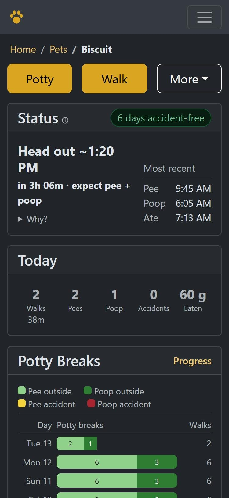

<p align="center"></p>

<h1 align="center">Housetrained</h1>

Track your pets' potty breaks, walks, meals, water, sleep and supplies, and follow a simple walk schedule you
set, with a coach that suggests changes from the accidents. Built for puppy house-training first, and works for
cats and other pets too. Self-hosted, private, works on phones.

**One household per install**, and **English only** for now.

Housetrained started as a fork of [Baby Buddy](https://github.com/babybuddy/babybuddy) and has gone its own way:
it tracks pets only.

<p align="center">
  
  
</p>

## What it does

- **Potty breaks**: pee, poop, where (outside, inside, pad, litter box; each pet has its own list), linked to
  the walk they happened on.
- **Walks**: one tap to start, one to end; for one pet or several; who walked, how far.
- **Next walk**: a simple schedule you set (pee every, poop every, out after a meal), with a coach that suggests
  changes from the accidents. See [how it works](docs/housetrained/schedule.md).
- **Food, water and litter**: what went into bowls, feeders and litter boxes, what each pet ate and drank, how
  much is left in each bag and when to buy more.
- **Sleep, weight, height, notes**, charts of the past two weeks, and a Progress page: accident-free streaks,
  week by week, where and when accidents happen.
- **Households**: everyone in the home logs together; owners, members and read-only people.
- **Phones first**: big buttons, forms that only show what applies, light and dark themes, metric or imperial.
- **Reminders** as phone or browser notifications, if you allow them: when a walk is due, a second one if
  nobody's out 10 minutes later (each can be turned off), when it's time to buy more food or litter (see
  [Private by design](#private-by-design)).
- **First-run checklist** on each pet's page: schedule, quiet hours, bowls, reminders.
- **Export everything** as CSV (Setup > Export), **import** past records, and a [REST API](docs/housetrained/api.md).

## Fill Bowl or Log Meal?

They're two different things, and that matters for the schedule:

- **Fill Bowl**: food, water or litter went into a bowl, feeder or litter box. It counts toward the bag, so you
  know how much is left. It says nothing about who ate it, or when.
- **Log Meal**: a pet ate or drank. Meals are what Next Walk uses: out a set time after eating or drinking.

Feed set portions that get eaten straight away (most dogs)? Tick **Eaten right away** when filling the bowl and
both are logged at once; the form remembers your usual amount for each bowl. Pets that graze from a bowl or
feeder (many cats): just top up with Fill Bowl, and log a meal when you notice them eating.

## Getting started

You need Docker. Copy [`compose.example.yaml`](compose.example.yaml) to `compose.yaml`, set your time zone and
the address you'll open it at, then:

```bash
docker compose up -d
```

It runs the published image (`ghcr.io/viciousnemesis/housetrained`, for amd64 and arm64). To build from this
code instead, replace the `image:` line with `build: .` and add `--build`.

Open `http://localhost:8000` and sign in as `admin` with the password printed in the log
(`docker compose logs housetrained`), or the one you set as `ADMIN_PASSWORD`. Change it under user menu >
Password.

Then, under **Setup**: add your pets, their bowls and litter boxes, and the food you buy. Calibrating a bowl
(weigh one usual scoop) lets "half a bowl" turn into grams. Want to look around first? Load a demo household:

```bash
docker compose exec -u 1000:1000 housetrained python manage.py housetrained_demo
```

(Use your `PUID:PGID` in place of `1000:1000`, so the database stays owned by the right user.)

(`--delete` removes it again.)

### Settings

| Variable | What it does |
|---|---|
| `TZ` | Server time zone (each person can pick their own in user settings) |
| `ALLOWED_HOSTS` | **Required.** Every hostname you open it at, comma-separated (e.g. `pets.example.com,localhost`) |
| `CSRF_TRUSTED_ORIGINS` | Every address you open it at, e.g. `https://pets.example.com` |
| `SECURE_PROXY_SSL_HEADER` | `True` behind a reverse proxy that handles HTTPS; cookies then go over HTTPS only |
| `SESSION_COOKIE_SECURE`, `CSRF_COOKIE_SECURE` | Override the cookie setting above (`False` to also sign in over plain HTTP) |
| `ADMIN_PASSWORD` | Password for the first admin (otherwise random, shown once in the log) |
| `PUSH_CONTACT` | Your `mailto:` address, sent with notifications so push services can reach you |
| `REMINDERS` | `False` to stop the server sending reminders |
| `HOUSETRAINED_SOURCE_URL` | Link shown as "Source Code" in the user menu |

Database, email and reverse-proxy sign-in settings (`DB_*`, `EMAIL_*`, `REVERSE_PROXY_AUTH`) work as in
[Baby Buddy's configuration docs](https://docs.baby-buddy.net/configuration/environment/). Security notes:
[docs/housetrained/security.md](docs/housetrained/security.md).

### Behind a reverse proxy (HTTPS)

Put it behind a proxy that handles HTTPS (Caddy, Nginx Proxy Manager, Traefik...) rather than opening port 8000
to the internet. Set `SECURE_PROXY_SSL_HEADER=True`, list the address in `CSRF_TRUSTED_ORIGINS` (e.g.
`https://pets.example.com`) and in `ALLOWED_HOSTS`, and make sure the proxy sends `X-Forwarded-Proto: https`.
Chained proxies (one handling HTTPS in front of another) must pass that header through; otherwise signing in fails
with a CSRF error. Reachable from the internet? Use strong passwords; a login rate limit is built in.

People: the admin creates accounts (user menu > Users; tick "Site admin" only for people who should manage the
site) and adds them to the household (Setup > Members), where their role is set. Roles cover pets and babies.

## Backups and updates

Everything lives in the `config` folder: the database (`data/db.sqlite3`), pet photos (`media`) and the
server's generated keys and settings. Stop
the container and copy that folder to back up; copy it back to restore. To take your records anywhere else,
Setup > Export downloads them all as CSV files (the same layout Import reads). To update, pull the new version and
run `docker compose up -d --build` again; database changes apply on start.

## Private by design

Housetrained runs entirely on your server. Pages load nothing from the internet (every script, style, font and
icon is bundled), and the app sends nothing anywhere: no analytics, no update checks, no accounts elsewhere.
A test (`pets/tests/test_privacy.py`) fails if a page ever loads something from outside.

The one exception is optional: **notifications**. Browsers deliver push notifications through their maker's
push service (Apple, Google or Mozilla), so turning them on for a device means your server hands encrypted
messages to that service. They can't read the content, but they do see that a message was sent to that device,
and when. They're off until a site admin allows them (Site Settings > Allow push notifications), and even
then each person turns them on for their own devices (user menu > Notifications). `REMINDERS=False` keeps them
off regardless. Email (password resets) is only sent if you set up a
mail server.

## Not veterinary advice

Predictions and charts are estimates from your own logs. Sudden changes in potty habits, eating or drinking are
worth a call to your vet.

## Development

```bash
pip install pipenv && pipenv install --dev
pipenv run python manage.py test
```

The pet code lives in `pets/`; design notes in [docs/housetrained](docs/housetrained). The theme is built from
`babybuddy/static_src` ([styles](docs/housetrained/styles.md)). Changes: [CHANGELOG.md](CHANGELOG.md).

## Support

If Housetrained helps, you can [buy me a coffee](https://buymeacoffee.com/brandonsmith.io). And please support
[Baby Buddy](https://github.com/babybuddy/babybuddy), which it's built on.

## License and credits

BSD 2-Clause, see [LICENSE](LICENSE). Built on [Baby Buddy](https://github.com/babybuddy/babybuddy) by its
contributors; icons and other third-party parts are listed in [NOTICE.md](NOTICE.md).
